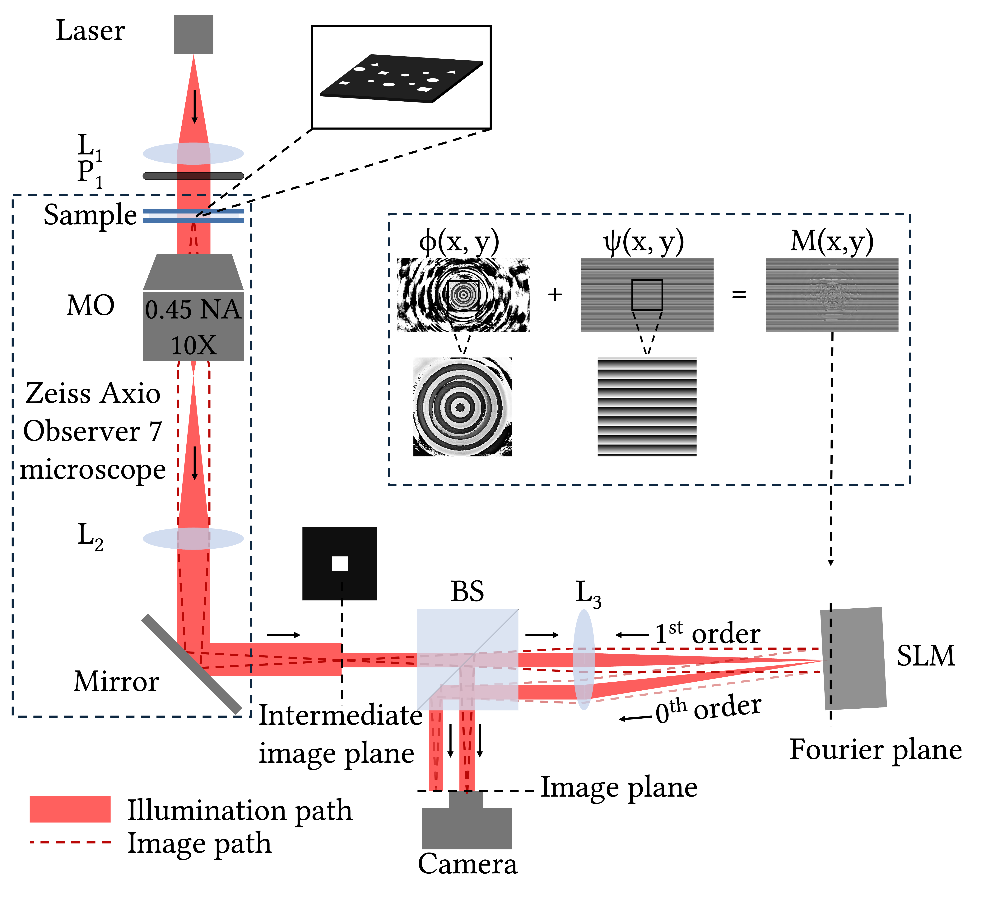

The project brought together our lab and colleagues in Moldova to develop polarization-sensitive digital holographic microscopy. It was financed under the 4th joint call of TÜBİTAK and NARD.

## Outputs

- [Dual-shot polarization DHM for full-field Jones matrix imaging](/publication/2026_bopex_hussein/), Biomedical Optics Express 2026
- [All-optical selective target highlighting for augmented-reality microscopy](/publication/2026_optcon_sahloul/), Optics Continuum 2026 ([project page](/projects/target-highlighting/), [supplementary material](https://opticapublishing.figshare.com/articles/journal_contribution/Supplementary_document_for_All-Optical_Selective_Target_Highlighting_for_Augmented_Reality_Microscopy_-_7967150_pdf/32886380?file=67315379))

